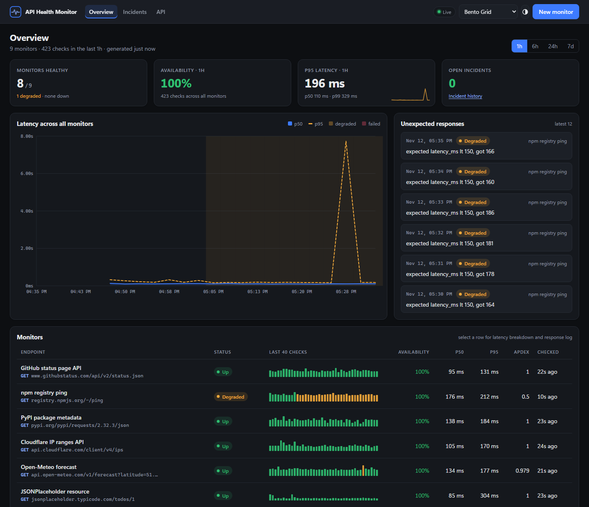
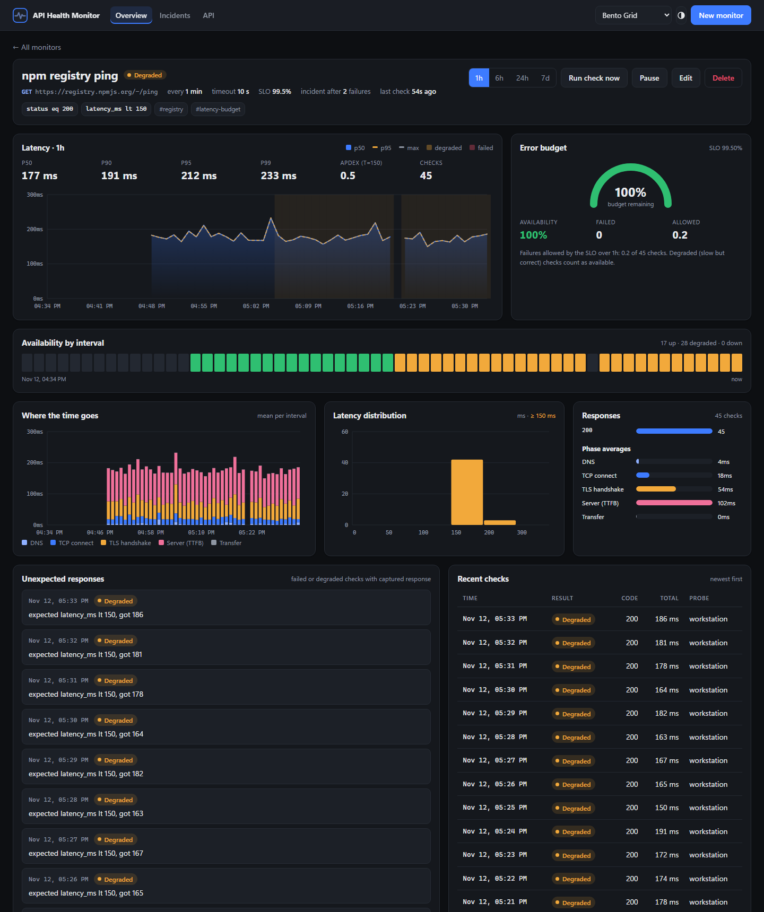
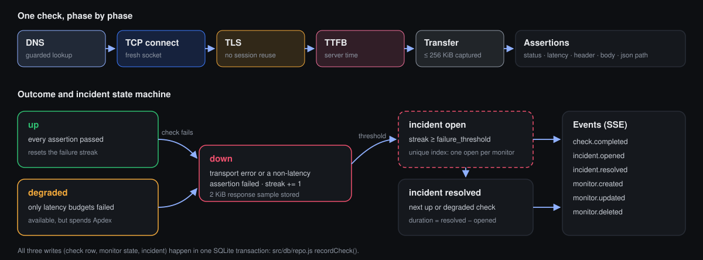
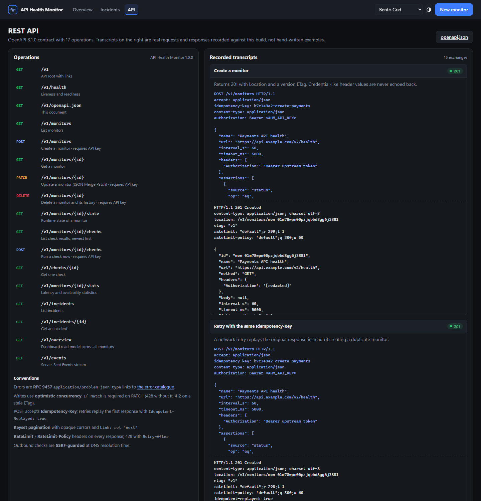
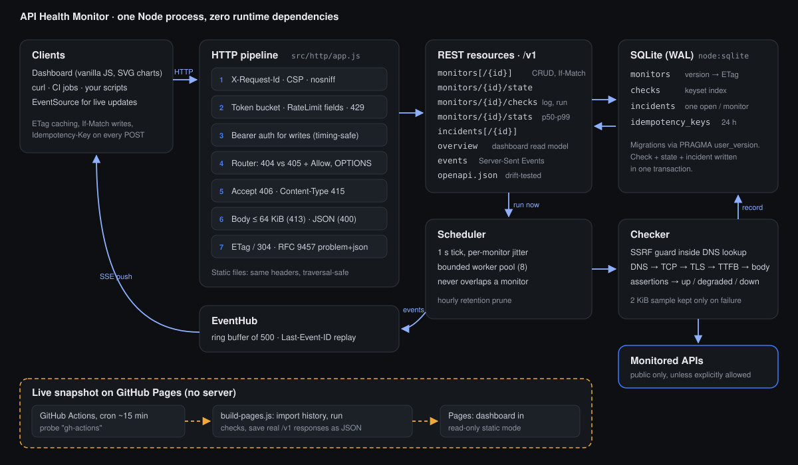
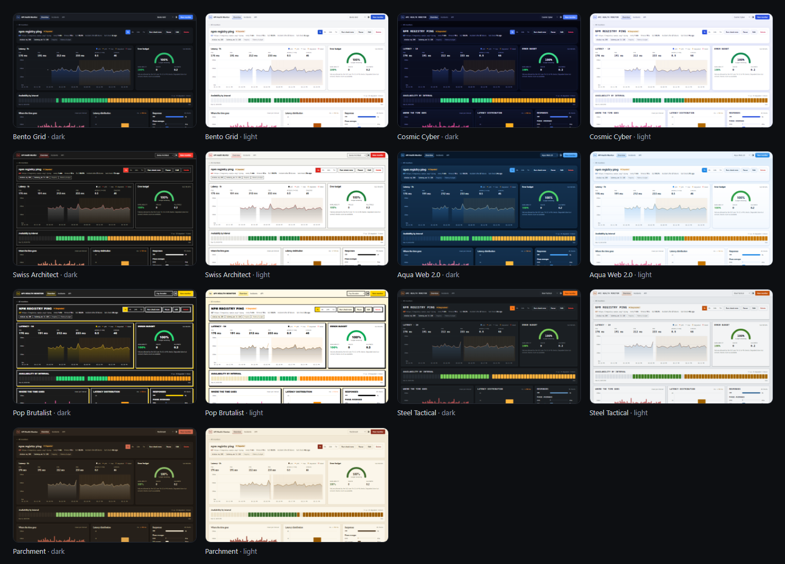
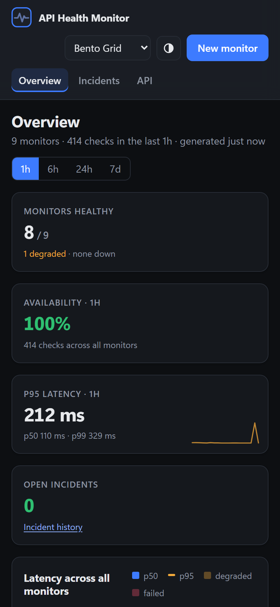

# API Health Monitor

A self-hosted control panel for testing APIs and watching for failures. Save endpoints as monitors, run scheduled checks with assertions, chart latency by connection phase, and keep a log of every unexpected response. One Node process, SQLite, zero runtime dependencies.

**Live snapshot:** https://mizcausevic-dev.github.io/api-health-monitor/ (read-only; a GitHub Actions job runs the real check engine about every 15 minutes and republishes it)



The repository is built to show REST API design decisions in working code, each one backed by a test:

| Decision | What the API does | Code | Test |
| --- | --- | --- | --- |
| Errors are data | Every error is RFC 9457 `application/problem+json` with a `type` URI that resolves to [documentation](https://mizcausevic-dev.github.io/api-health-monitor/errors.html), a `request_id`, and JSON Pointers for field errors | [`problem.js`](src/http/problem.js) | `create: 201 + Location...` |
| Lost-update protection | `PATCH` requires `If-Match` (428 without it, 412 on a stale ETag). The ETag is the config `version`, so health checks never invalidate it | [`routes.js`](src/api/routes.js) | `conditional requests...` |
| Safe retries | `POST` honours `Idempotency-Key`: a retry replays the stored response (`Idempotent-Replayed: true`); the same key with a different body is a 422 | [`routes.js`](src/api/routes.js) | `Idempotency-Key replays...` |
| Partial updates | JSON Merge Patch (RFC 7396) with `application/merge-patch+json`; `null` deletes a key | [`validate.js`](src/api/validate.js) | `merge patch (RFC 7396)...` |
| Stable pagination | Keyset cursors (not `OFFSET`), `Link: <...>; rel="next"`, cursors bound to their sort order | [`repo.js`](src/db/repo.js) | `keyset pagination...` |
| Loud failure | Unknown query parameters and unknown body fields are rejected. A typo returns 400/422, not a quietly wrong 200 | [`routes.js`](src/api/routes.js) | `keyset pagination...` |
| HTTP semantics | 404 vs 405 with `Allow`, automatic `OPTIONS` and `HEAD`, 406 / 415 / 413, `201 + Location` for created resources, `304` on `If-None-Match` | [`app.js`](src/http/app.js) | `method semantics...` |
| Quota visibility | Token bucket per client, `RateLimit` and `RateLimit-Policy` fields on every response ([IETF draft](https://datatracker.ietf.org/doc/draft-ietf-httpapi-ratelimit-headers/)), 429 + `Retry-After` | [`ratelimit.js`](src/http/ratelimit.js) | `rate limiting...` |
| Contract drift | OpenAPI 3.1 document served at `/v1/openapi.json`; a test fails if a route exists in the router but not in the spec, or the reverse | [`openapi.js`](src/api/openapi.js) | `OpenAPI document covers...` |
| Push, not poll | Server-Sent Events at `/v1/events` with a 500-event ring buffer, so a reconnect with `Last-Event-ID` replays what was missed | [`events.js`](src/http/events.js) | `SSE...` |
| Outbound safety | The SSRF guard runs inside the socket's DNS lookup, so the address that is validated is the address that is connected to | [`ssrf.js`](src/engine/ssrf.js) | `SSRF...` |

`npm test` runs 48 tests (unit and real-HTTP integration) in about 1.5 seconds with Node's built-in runner.

## What a check measures

Each check opens a cold connection (a fresh agent: no pooled socket, no TLS session reuse) and records five phases from socket events: DNS, TCP connect, TLS handshake, time to first byte, and transfer. Assertions then classify the result:

- **up**: every assertion passed
- **degraded**: only latency budgets failed (reachable and correct, but slow)
- **down**: a transport error (`timeout`, `dns_failure`, `tls_error`, `blocked_target`...) or any non-latency assertion failed

A run of `down` results that reaches the monitor's `failure_threshold` opens an incident; the next passing check resolves it. Healthy responses store no body. Unexpected ones keep what the monitor's `capture` setting allows:

| `capture` | A failed check stores | Use for |
| --- | --- | --- |
| `sample` (default) | 2 KiB of body, selected headers, and the observed value in each failed assertion | Public endpoints |
| `status_only` | Status, timings and which assertion failed, without observed values | Authenticated or internal APIs |
| `none` | Status and timings only: failed assertions reduced to their index, no remote address, errors reduced to their code | Endpoints whose responses or network location must never be stored |

Everything a check stores is served by the API and can reach a published snapshot, so the setting is the control point, not a display filter. Tightening it (`sample` to `status_only` or `none`) also scrubs the monitor's stored checks and incident causes, and the snapshot build re-applies each monitor's policy to the history it imports, so data published before the change stops being republished on the next deploy.

### Error budget

Each window reports `allowed_failures = checks × (1 − SLO)`. When that is below one, a single failure would read as "−100 % remaining", which says more about the sample size than the service. In that case the API returns `status: "insufficient_data"`, `remaining: null` and `min_checks` (200 for 99.5 %, 1,000 for 99.9 %), and the dashboard says so instead of drawing a gauge.

## Alerts

Incident transitions (`incident.opened`, `incident.resolved`) are sent to one webhook, signed per [Standard Webhooks](https://www.standardwebhooks.com/): `webhook-id`, `webhook-timestamp` and `webhook-signature: v1,<base64 HMAC-SHA256 of id.timestamp.body>`. The id is derived from the incident and transition, so a retried or re-run delivery carries the same id and the receiver can drop the duplicate. Individual checks never alert; a degraded (slow but correct) check never opens an incident.

| Variable | Purpose |
| --- | --- |
| `AHM_WEBHOOK_URL` | https endpoint. A Slack or Discord URL is a credential, so it is read from the environment only: never stored, returned by the API or published. |
| `AHM_WEBHOOK_SECRET` | `whsec_` + at least 24 random bytes in base64 (`echo whsec_$(openssl rand -base64 32)`). |
| `AHM_WEBHOOK_FORMAT` | `json` (signed event envelope, default), `slack` (`text`) or `discord` (`content`, mentions disabled). In both chat formats `<`, `>`, `&` are escaped (Slack) and the cause, which can contain text chosen by the failing server, sits inside a code span, so it cannot inject mentions, masked links or formatting. |
| `AHM_WEBHOOK_HOSTS` | Optional allowlist of receiver hostnames, e.g. `hooks.slack.com`. |
| `AHM_PUBLIC_URL` | Optional base URL for the monitor link in the message. |

Delivery goes through the same SSRF guard as checks, retries network errors, 408, 429 and 5xx at 0 s, 5 s, 30 s and 2 min (or the receiver's `Retry-After`, up to 60 s), stops on other 4xx, and holds at most 100 pending deliveries. The Pages notify job delivers in parallel with shorter backoff so it stays inside its 5-minute limit. The payload carries the incident (monitor, cause, failed-check count, times), never a response sample.

### Incident feed

Incidents are also published as an Atom 1.0 feed (RFC 4287): `GET /v1/feeds/incidents` on a running server, and [`incidents.xml`](https://mizcausevic-dev.github.io/api-health-monitor/incidents.xml) on the live snapshot, both rendered by [`feed.js`](src/api/feed.js). One entry per incident (stable `tag:` id), updated when it resolves. The feed is its own resource rather than a content-negotiated view of `/v1/incidents`, because many feed readers send `Accept: */*` and would otherwise get JSON. Cause strings come from failing servers, so every text node is XML-escaped and characters XML 1.0 forbids are dropped. The dashboard links it from the Incidents page and `<link rel="alternate">` makes it discoverable. Set `AHM_PUBLIC_URL` so links do not depend on the request's `Host` header.

On the live snapshot, the build records the transitions from its own run, and a separate `notify` job delivers them only after the deploy succeeds. The webhook secrets are scoped to that job, and without them it exits cleanly. To get alerts from the demo, add `AHM_WEBHOOK_URL` and `AHM_WEBHOOK_SECRET` as repository secrets (and optionally an `AHM_WEBHOOK_FORMAT` variable).





Assertion sources: `status`, `latency_ms`, `header`, `body`, `json` (dot paths such as `status.indicator` or `items[0].id`). Operators: `eq`, `neq`, `lt`, `lte`, `gt`, `gte`, `contains`, `not_contains`, `in`, `exists`, `not_exists`. There is deliberately no regex operator: user-supplied patterns run against third-party response bodies are a ReDoS vector, and `contains` / `eq` cover the realistic cases.

## Quick start

Requires Node 22.13 or newer (uses the built-in `node:sqlite`). There is nothing to install.

```bash
git clone https://github.com/mizcausevic-dev/api-health-monitor.git
```

```bash
cd api-health-monitor && npm run demo
```

Open http://127.0.0.1:8080. `npm run demo` seeds the nine public monitors used on the live site; `npm start` starts empty.

Create a monitor from the command line:

```bash
curl -i http://127.0.0.1:8080/v1/monitors -H "Content-Type: application/json" -H "Idempotency-Key: $(uuidgen)" -d '{"name":"httpbin","url":"https://httpbin.org/status/200","interval_s":60,"assertions":[{"source":"status","op":"eq","target":200},{"source":"latency_ms","op":"lt","target":800}]}'
```

The API tab in the dashboard shows recorded request/response transcripts for every behaviour in the table above. They are generated by running real requests against a throwaway server during the build ([`scripts/transcripts.js`](scripts/transcripts.js)), not written by hand.



## Configuration

| Variable | Default | Purpose |
| --- | --- | --- |
| `AHM_HOST` / `AHM_PORT` | `127.0.0.1` / `8080` | Bind address. The server refuses a non-loopback host unless `AHM_API_KEY` is set. |
| `AHM_API_KEY` | none | Bearer key (24+ characters) required for every write. |
| `AHM_PUBLIC_READ` | `true` without a key, `false` with one | With a key set, reads need it too unless this is `true`. Anonymous readers then get query values and request bodies redacted. |
| `AHM_DB` | `data/ahm.db` | SQLite file (WAL mode). |
| `AHM_ALLOW_PRIVATE_TARGETS` | `false` | Allow monitoring private, loopback and link-local addresses. Turn on only when the deployment is meant to watch its own network. |
| `AHM_RATE_LIMIT` | `300` | Requests per client per minute. Triggering a check costs 10. |
| `AHM_CORS_ORIGINS` | none | Comma-separated origins allowed to call the API from a browser. |
| `AHM_TRUST_PROXY` | `false` | Use `X-Forwarded-For` for the client address. Only behind a proxy you control. |
| `AHM_RETENTION_DAYS` | `30` | Check history kept. |
| `AHM_MAX_CONCURRENCY` | `8` | Simultaneous outbound checks. |
| `AHM_PROBE` | `local` | Label stored on each check (useful when several probes report). |

## Architecture



- **No framework.** The router, pipeline, rate limiter and problem responses are about 450 lines across [`src/http`](src/http). The point is to make each HTTP decision visible instead of inherited from middleware defaults.
- **The monitor resource is configuration only.** Runtime health lives at `/v1/monitors/{id}/state`. If health were part of the monitor, every check would change its representation, bump its ETag, and make every `If-Match` edit fail.
- **One transaction per check.** The check row, the monitor's status and failure streak, and any incident change are written together ([`recordCheck`](src/db/repo.js)), backed by a partial unique index that allows one open incident per monitor.
- **`/v1/overview` is a read model.** The dashboard's landing view needs per-monitor summaries; one aggregate request replaces 1 + 2N calls.

### How the live page works without a server

GitHub Pages only serves static files, and a public write-capable monitor is an open proxy for anyone to aim at third parties. So the live site has no API server. Every 15 minutes a [workflow](.github/workflows/pages.yml):

1. downloads the history the site already publishes (`data/export.json`),
2. runs one real round of checks from the runner (probe `gh-actions`),
3. starts the real API in-process and saves its responses as JSON files at the paths the dashboard's static client reads ([`static-path.js`](public/js/static-path.js)),
4. deploys the result.

Every JSON file on the site is a byte-for-byte response from the same code that serves `/v1`, requested as an anonymous reader of a keyed server: the snapshot shows what a public reader of a self-hosted instance would see (query values and request bodies redacted), not the operator's view. Before upload the build fails if any file is not a web-servable type or contains a secret: any `AHM_SECRET_*`, `AHM_WEBHOOK_*` or API key value, or any stored monitor header value outside the safe-header allowlist, in raw, JSON-escaped or URL-encoded form. The site is its own database. History before the first scheduled run came from a workstation probe (labelled `workstation` on each check).

The demo monitors are public endpoints intended for programmatic use (status pages, package registries, open data APIs), polled at most every 15 minutes with an identifying `User-Agent`. Only status, timing and, for failures, a 2 KiB sample are stored.

## Security model

- Writes need the API key; the server will not bind to a public interface without one, and once a key is set, reads need it too unless `AHM_PUBLIC_READ=true`. The key comparison is constant-time over SHA-256 digests.
- Without a key the server only answers to `127.0.0.1`, `localhost` or `[::1]` in the `Host` header, so a DNS-rebinding page cannot drive a local instance.
- Monitor URLs must be `http(s)`, carry no credentials, and (by default) resolve only to public addresses, including the IPv4 address embedded in IPv4-mapped, NAT64 and 6to4 IPv6 forms. A hostname with one public and one private record is refused. Redirects are off by default. When enabled, each hop goes through the same guard, an https-to-http downgrade is refused, and configured headers and body are never sent to a different origin. Changing a monitor's URL to a new origin drops its non-safe headers too.
- Header values are redacted by allowlist: only headers known to carry no secret (`Accept`, `Content-Type`, `User-Agent`...) are echoed. A denylist always misses some vendor's key header. Sending `[redacted]` back in a PATCH keeps the stored value instead of overwriting it.
- The dashboard runs under `Content-Security-Policy: default-src 'self'` with no inline script; only inline `style` attributes are allowed (`style-src-attr`), which chart geometry needs. Every server-supplied string is escaped before rendering, including response bodies captured from monitored servers.

See [SECURITY.md](SECURITY.md) for reporting.

## Themes

Seven themes, each with light and dark modes, chosen per browser and stored in `localStorage` (no cookies, no analytics). Charts read colors from the same CSS custom properties, so switching never re-renders data. Preview any theme with `?theme=swiss&scheme=light`.



The layout collapses to one column on phones, and the monitor table scrolls inside its own card rather than the page.



## Limits and trade-offs

- **Single node.** The scheduler and rate limiter are in-process. Running two replicas against one database would double the checks. Horizontal scale needs a lease per monitor (for example a `locked_until` column) and a shared limiter.
- **Webhook retries live in memory.** Delivery is best effort: a process restart drops pending retries. Ids are stable, so when a delivery is repeated (for example, a re-run notify job), receivers can drop the duplicate. A durable outbox table is the next step if alerts must survive restarts.
- **Synchronous "run now".** `POST /v1/monitors/{id}/checks` waits for the check (bounded by the monitor's timeout, at most 30 s). An async `202 Accepted` with a status resource is the better fit if timeouts grow.
- **Cold-connection timings.** Every check pays DNS + TCP + TLS. That matches a new client's experience but overstates latency for clients that reuse connections.
- **Snapshot cadence.** GitHub delays scheduled workflows under load, and disables them after 60 days without repository activity.

## Repurposing

The same engine is a synthetic-monitoring core for other verticals: a partner-integration SLA tracker for a B2B platform (one monitor per customer webhook, error budget per contract), a public status page generator (the static snapshot is already one), or a payment-provider health board for a checkout team. Only `demo/monitors.json` and the assertion set change.

## Project layout

```
src/http      pipeline, router, problem details, rate limiter, SSE hub
src/api       routes, validation, OpenAPI document
src/engine    checker, SSRF guard, assertions, scheduler, statistics
src/db        migrations and all SQL
public        dashboard (no build step)
scripts       static snapshot build, history export/import, transcripts
test          node:test suites
```

## License

MIT. See [LICENSE](LICENSE).
